# ニチジョウ・ファイターズ (NICHIJO FIGHTERS)

パソコン1台・キーボード1つで2人対戦できる、スマブラ風のシンプルな2D対戦アクションゲームです。
スマホでもタッチ操作でCPUと対戦できます。ブラウザだけで動く単一の `index.html`（外部ファイル・通信なし）です。

**ブラウザですぐ遊ぶ → https://premiumhuman.github.io/nichijo-fighters/** （PC・スマホ共通）

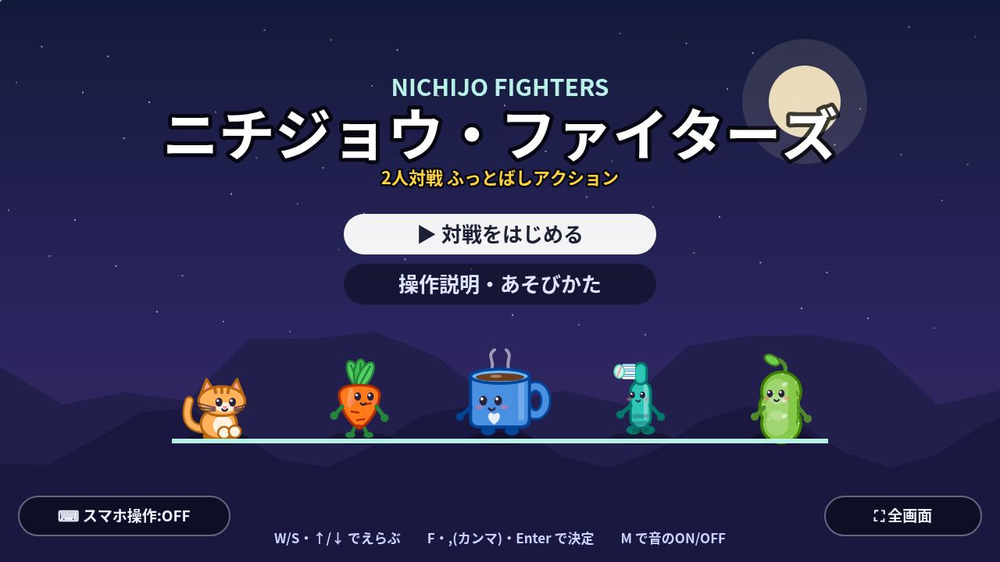

## あそびかた
1. 上のURLを開く（または `index.html` をダウンロードして、ブラウザ（Chrome / Edge / Firefox など）で開く）
2. タイトルで「対戦をはじめる」→ 2人がそれぞれキャラクターを選んで決定
3. 相手をステージの外までふっとばそう！ ストックが先に0になった方の負け

- ダメージ% が高いほど遠くへふっとびます
- 強攻撃はタメ（予備動作）が長いので、見てからガードできます
- 読み合いの三すくみ：**攻撃 → つかみに勝つ / つかみ → ガードに勝つ / ガード → 攻撃に勝つ**

## CPU対戦（人 vs 人 / 人 vs CPU / CPU vs CPU）
キャラ選択画面で、各プレイヤー枠の **W/S（P2は ↑/↓）** を押すと「人間 → CPU Lv1〜Lv7」を切り替えられます（スマホは Lv1〜Lv7 ボタンをタップ）。

| レベル | 名前 | 反応時間(目安) | どんな動き？ |
|---|---|---|---|
| Lv1 | かんたん | 約330ms ±70 | のんびり。ガードも反撃も半分以下、ミスも多い |
| Lv2 | ふつう | 約250ms ±50 | 強攻撃をそこそこ見てからガード。ときどき反撃 |
| Lv3 | つよい | 約200ms ±35 | 以前の「Lv5 めっちゃつよい」と同じ強さ |
| Lv4 | めっちゃつよい | 約170ms ±35（最速 約120ms） | ここから「うまさ」が増える：空振り・着地のスキに反撃、ガード後につかみ返し、ふっとばした相手へ追撃、対空 |
| Lv5 | たつじん | 約150ms ±25（最速 約120ms） | 相手のリーチぎりぎり外で待つ差し合い、ガードを固める相手をつかむ、崖外へ追撃、お手玉から逃げる |
| Lv6 | めいじん | 約130ms ±25（最速 約100ms） | 上の全部がより確実に。必殺技はほぼ当たる場面と反撃にしか使わない |
| Lv7 | さいきょう | 約120ms ±20（最速 約100ms） | ミスはほぼなし。クセ読みも最大。腕に自信のある人向け |

- 1人でCPU戦：自分のキャラを決定したあと、**自分のキーでCPU枠のキャラも選んで決定**できます
- CPU同士：両方の枠をCPUにすれば観戦モード
- ストック数は **Q / E** で変更

### CPUは「人間っぽく」動きます
- CPUはキーボードと同じ「仮想キー」を押す/離すだけで操作します（キャラの状態を直接いじらない）。入力バッファ・物理もプレイヤーと共通です
- 相手の様子は**反応時間ぶん遅れて**しか見えません（毎回ばらつきあり）。考え直す間隔にも上限があります
- 強攻撃のタメは「見えてから」ガード。反応が間に合わなければ普通に食らいます
- 間合いのブレ、ときどきの判断ミス、ボタンを押す長さのばらつき、崖の手前で止まる、復帰で焦って遅れる…などを再現
- 読み合いは相手のクセ（ガードが多い・攻撃が多い・つかみが多い）を覚えて、つかみ/攻撃/ガードの配分を変えます。記憶は少しずつ薄れます
- 高レベルほど反応が速く安定していて判断も良いですが、完璧ではありません（反応時間は最速でも約100ms＝6フレームで、毎回ばらつきます。フレーム単位の最適行動はしません）
- Lv4〜Lv7 の強さは「ズル」ではなく**うまさ**です：
  - 見えた相手のスキ（空振り・着地・必殺技の空振り）の残り時間を見積もり、**間に合う技だけ**で反撃（届かなければ走って詰める）
  - ガードした直後につかみ返す／ガードを固めている相手はつかみに行く／自分がガード中に相手が目の前に来たらジャンプで逃げる
  - ふっとばした相手の落下地点を予測して上攻撃・空中攻撃で追撃、崖の外の相手には少しだけ飛び出して空中攻撃（深追いはしない）
  - 下で待ち構えられたら横へ逃げて急降下（お手玉されない）、空中から攻めて落とされると空中攻撃を控える
  - 相手の技が届かない距離で待って空振りを誘い、リーチで勝つキャラは先端を当てる（ハブラシは地上戦を重視）。膠着が長いと自分から攻める
  - 必殺技は「当たる場面」（相手の大きなスキ・必殺技の空振り）を優先し、相手の必殺技には技ごとに正しい避け方（ビーム/ウェーブはジャンプ、噴火は離れる）
- **キャラごとの戦い方**もCPUが使い分けます（どのレベルでも同じ「人間っぽい」反応時間の制限つき）：
  - ネコ：空中から攻めて、空中前攻撃・とびかかりで飛びこむ
  - ニンジン：走りこんでスライディング、ジャブ連打で手数勝負
  - マグカップ：弱い攻撃を出してくる相手にアーマー付きスマッシュで押し切る、つかみ・投げ多め
  - ハブラシ：先っぽが当たる距離を保ち（近すぎたら下がる）、飛んでくる豆をブラシではらう
  - エダマメ：距離を取って豆を撃つ、離れたらためて保存→当たる時に大豆、走ってくる相手には置き豆、近づかれたら後ろへ跳んで空中から撃つ、崖外の相手を豆で追撃
- **飛び道具への対応**：飛んでくる豆を（反応時間ぶん遅れて）見て、ガード／ジャンプで越えて近づく。豆が来ている最中に遅い技は振らない

## キャラクター
野菜・動物・毎日使う身の回りのものが戦います。5人それぞれ **リーチ・技の速さ・重さ・動き方** がはっきり違い、立ち回りがまったく変わります。

- **ネコ**（動物／エアリアル）… **3段ジャンプ**とすばやい空中技で空から崩す。空中前攻撃は前へ飛びこみ、走りながらの弱攻撃は「とびかかり」。
- **ニンジン**（野菜／ラッシュ）… **いちばん足が速くて軽い**突撃役。発生の早い連打ジャブと走り弱攻撃の**スライディング**で、懐にもぐって手数で押す（リーチは短い）。
- **マグカップ**（日用品／パワー）… **いちばん重くて遅い**が一撃が強烈。強攻撃・↑＋強攻撃は**アーマー付き**で、ため中に弱い攻撃を受けてもひるまず押し切る（つかみ・強い攻撃・必殺技・豆には破られる）。
- **ハブラシ**（日用品／リーチ）… **いちばん長いリーチ**で間合いを制するスペーサー。**ブラシの先っぽを当てると「先端!」**でダメージ・ふっとびが増える。出が遅めなので距離管理が命。
- **エダマメ**（野菜／シューター）… **豆を撃って近づかせない**ゾーナー。ちょん押しで速い小豆、長押しで**ため撃ちの大豆**（ためは保存もできる）。接近戦は苦手で、ふわっと浮いて地上ではよく滑る。

### エダマメの技
| 入力 | 技 | 内容 |
|---|---|---|
| 強攻撃ボタンを**ちょん押し** | まめ鉄砲 | 小さくて速い豆（画面に1つまで）。発生が早く、走ってくる相手を止める |
| 強攻撃ボタンを**長押し**して離す | ため撃ち | ためるほど大きく・重く・よくふっとぶ豆に（最大約0.75秒。大きい豆は画面に1つまで） |
| ため中に **ガード** または **ジャンプ** | ため保存 | ためた分をとっておける（体のまわりを豆が回る）。次に強攻撃ボタンを押すと**即発射** |
| 空中で強攻撃 | 空中まめ撃ち | 保存したため豆、なければ小さな豆を空中から撃つ |
| ↑＋強攻撃（地上） | さやポップ | 真上へのはじき。接近されたときの対空・撃墜技 |

豆のルール：**ガードできる**（反射はなし）。相手の攻撃が当たると**打ち消される**（大きな豆は弱攻撃では消えない／必殺技の豆は消えない）。豆どうしは大きい方が残る。**豆はマグカップのアーマーを貫通**します。

## 必殺技
攻撃を当てる（受けた時も少し）と、HUDの％の下にある **必殺技ゲージ** がたまります（1ストックで1〜2回くらい）。
満タンになるとゲージとキャラが金色に光り「必殺技OK!」と表示されるので、**必殺技ボタン**（P1: **R** / P2: **L** または テンキー4 / スマホ: 「必殺」ボタン）で発動！
発動するとカットインが入り、少しの「ため」のあとに技が出ます。ため中は本人は無敵ですが、**相手はガード・回避・ジャンプでかわせます**（見てから反応できる長さ）。空振りすると大きなスキができます。ゲージが足りない時に押すと「まだ!」と出るだけです。

| キャラ | 必殺技 | 内容 |
|---|---|---|
| ネコ | **ネコまっしぐら** | 残像を残して前方へ一直線にダッシュし、爪で連続ひっかき→最後にふっとばし |
| ニンジン | **キャロットビーム** | 正面に太いオレンジのビーム。連続ヒットして最後にふっとばす（ジャンプでよけられる） |
| マグカップ | **熱々コーヒー噴火** | 足もとからコーヒーの間欠泉と湯気が大爆発。周りの相手を真上に打ち上げる |
| ハブラシ | **ミントブラスト** | 歯みがき粉の泡の大波が地面を走る。遠くまで届く一撃（ハブラシはゲージが少し早くたまる） |
| エダマメ | **まめまめガトリング** | 豆を連射して相手をつつき続け、最後に金色の特大豆でドーン！ 画面の端まで届く（ジャンプ・ガードで対処できる） |

CPUも必殺技を使います（当たりそうな時に使う・わざと温存する・たまに焦って無駄撃ちする）。相手の必殺技も、反応時間が間に合えばガードやジャンプでかわします。

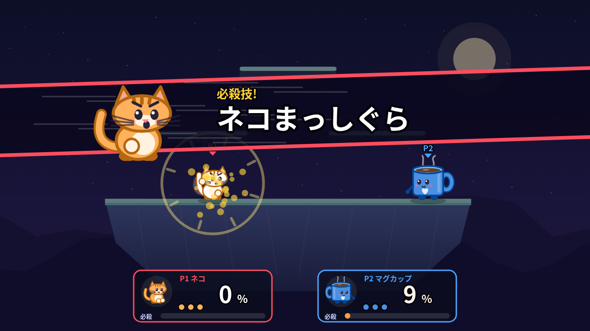
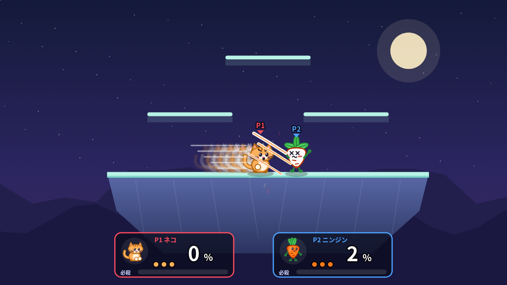
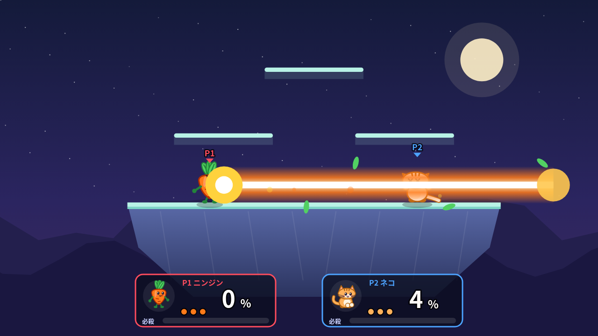
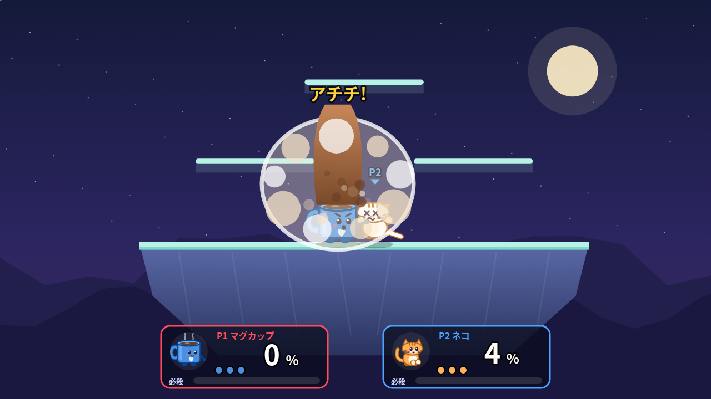
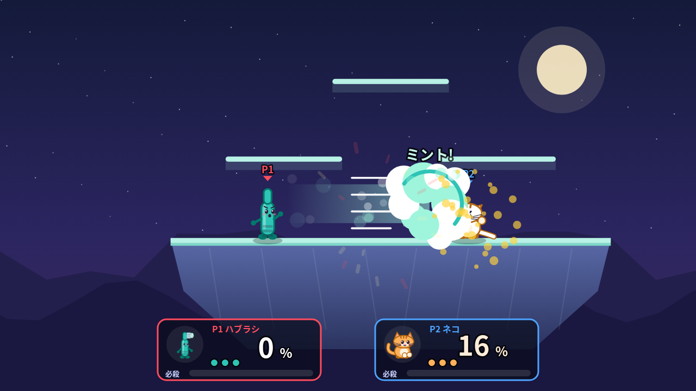
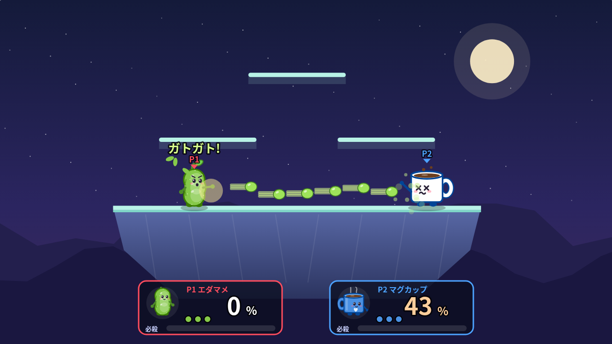
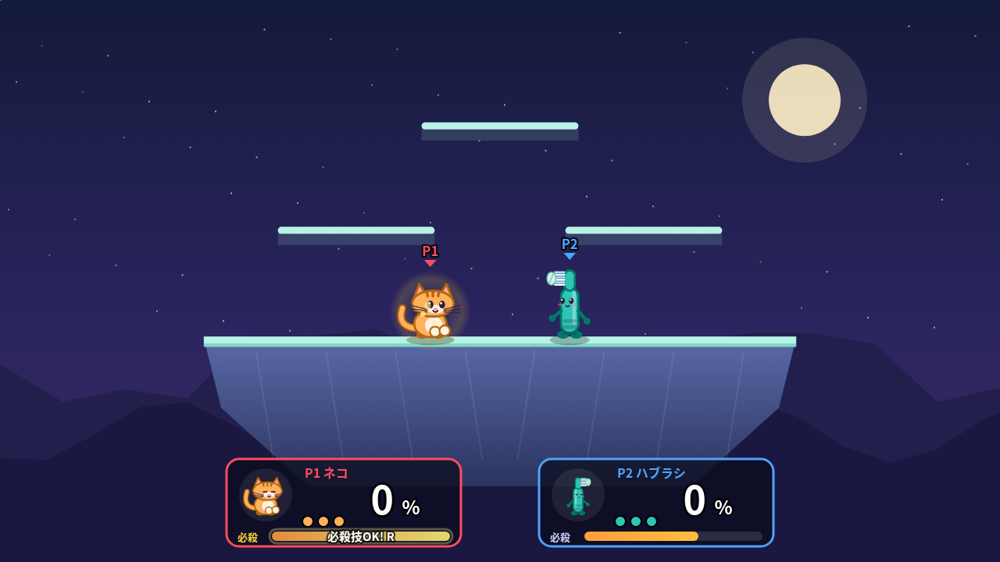

## 操作方法
| 操作 | プレイヤー1 | プレイヤー2 |
|---|---|---|
| 移動 | A / D | ← / → |
| ジャンプ（空中でもう1回） | W | ↑ |
| すり抜け / 急降下 | S | ↓ |
| 攻撃（↑と同時で上攻撃） | F | , （カンマ） または テンキー1 |
| 強攻撃（空中で↑+強攻撃＝復帰技） | G | . （ピリオド） または テンキー2 |
| ガード | H | / （スラッシュ） または テンキー3 |
| 必殺技（ゲージ満タンで） | R | L または テンキー4 |

- つかみ：ガード中に攻撃（P1: H+F、P2: / + ,）
- 回避：ガード中に ←/→（ころがり回避）、↓（その場回避）、空中でガード（空中回避）
- Esc / P：ポーズ　　M：サウンドON/OFF

## バランス調査（CPU同士の大量シミュレーション）
ゲーム本体と同じコード（`index.html` の中身）を Node.js で高速実行し、人間らしいCPU同士で全16カード（ミラー含む）を左右入れ替えて対戦させました。
詳しい数値は [BALANCE.md](BALANCE.md)、再現用スクリプトは `tools/sim/`（キャラ相性: `node tools/sim/run.js 150 7`、レベル同士: `node tools/sim/ladder.js 15 7 6`）。
5キャラ総当たりを全CPUコアで並列に回して、キャラ別勝率と 5×5 相性表（95%信頼区間つき）を出すには `node tools/sim/rr.js --lv 7 --games 60`（1カード各サイド60試合、`--procs` でプロセス数、`--lv2` で別レベル相手、`--json` で結果保存）。

**CPU 7段階化（2026-10）後の勝率（ミラー除く、各2400試合、95%信頼区間 ±3.3pt）**

| キャラ | Lv3 つよい | Lv4 めっちゃつよい | Lv5 たつじん | Lv7 さいきょう |
|---|---|---|---|---|
| ネコ | 52.2% | 51.7% | 46.6% | 48.0% |
| ニンジン | 44.6% | 47.2% | 50.3% | 51.3% |
| マグカップ | 50.4% | 45.9% | 46.9% | 51.0% |
| ハブラシ | 52.8% | 55.2% | 56.2% | 49.7% |

上のレベルほど「スキを確実に突く」ので、そのままだと Lv7 で ニンジン 70% / ハブラシ 19% まで偏りました。ニンジンの技の後スキを少し長く（endlag 0.95→1.14）、ハブラシの後スキを少し短く・急降下を速く（endlag 0.9→0.83、急降下 12→14.5）して調整しています。

**レベルの階段（全16カード×左右入替、各480試合）**: Lv2→Lv1 86.9% / Lv3→Lv2 74.4% / Lv4→Lv3 77.5% / Lv5→Lv4 67.9% / Lv6→Lv5 73.3% / Lv7→Lv6 68.8%（上のレベルの勝率）。新Lv3 vs 旧Lv5 は 50.2%（同じ強さ）、Lv7 vs 旧Lv5 は 98.8%。

7段階化の前（Lv1〜5時代）・必殺技を入れて再調整した後の勝率

**（旧レベル表記）必殺技を入れて再調整した後の勝率（ミラー除く、95%信頼区間 ±2.3〜2.8pt）**

| キャラ | Lv3 ふつう | Lv4 つよい | Lv5 めっちゃつよい |
|---|---|---|---|
| ネコ | 46.8% | 52.3% | 51.8% |
| ニンジン | 46.9% | 49.4% | 53.3% |
| マグカップ | 47.0% | 51.1% | 46.2% |
| ハブラシ | 59.3% | 47.3% | 48.8% |

必殺技の発動は 1ストックあたり約1.5回（ハブラシは約2回）、命中率 45〜58%、必殺技による撃墜は全撃墜の約12%で、どれか1つが強すぎることはありません。

**（旧レベル表記）必殺技を入れる前の勝率**

| キャラ | Lv3 ふつう | Lv4 つよい | Lv5 めっちゃつよい |
|---|---|---|---|
| ネコ | 45.3% | 50.2% | 51.7% |
| ニンジン | 47.0% | 50.4% | 54.3% |
| マグカップ | 50.6% | 53.6% | 45.3% |
| ハブラシ | 57.2% | 45.8% | 48.8% |

最初の調整前（旧Lv4）は ハブラシ 71.6% / マグカップ 59.8% / ネコ 50.0% / ニンジン 18.6% でした。
※ハブラシは「反応が遅いほど強い」傾向があり、いちばん下のレベル同士だと有利です。

## スマホでの遊び方
スマホ・タブレットで開くと自動で「スマホ操作」になります（タイトル画面の「スマホ操作:ON/OFF」で切り替えも可能）。
**横向き**で遊んでください（縦向きだと「横向きにしてね」と表示されます）。タイトルやポーズ画面の「全画面」ボタンで全画面表示にもできます（対応ブラウザのみ）。

- スマホでは **あなた（P1） vs CPU** の対戦です
- キャラ選択：カードをタップして「あなた」→「あいて(CPU)」の順にキャラを選び、CPUの強さ（Lv1〜7）とストック数をタップで決めて「バトル開始！」
- メニュー（タイトル・操作説明・キャラ選択・ポーズ・リザルト）はすべてタップで操作できます

### ホーム画面に追加して全画面で遊ぶ（アプリ版）
ブラウザのURLバーを消して全画面で遊ぶには、ホーム画面に追加して「アプリ」として起動するのがおすすめです。一度開けばオフラインでも遊べます。

**iPhone（Safari）**
1. 画面下（または上）の共有ボタン **□↑** をタップ（見当たらない時は「…」→「共有」）
2. メニューを下にスクロールして **「ホーム画面に追加」**
3. 右上の **「追加」**
4. ホーム画面にできた「ニチジョウ」のアイコンから起動 → URLバーなしの全画面で遊べます

**iPhone（Chrome）**
1. アドレスバーの右端にある共有ボタン **□↑** をタップ
2. **「ホーム画面に追加」** → **「追加」**
3. ホーム画面のアイコンから起動

※ iPhone のブラウザはゲーム画面の「全画面」機能に対応していないため、タイトル画面の「⛶ 全画面」ボタンを押すと上の手順をイラスト付きで案内します。

**Android（Chrome など）**
- タイトル画面の **「⛶ 全画面」** ですぐに全画面＋横向き固定になります（戻るジェスチャーで解除）
- **「📲 アプリとして追加」** ボタン（表示された場合）、またはブラウザのメニュー **⋮ →「ホーム画面に追加」/「アプリをインストール」** でアプリ化できます

アプリとして起動している時は全画面ボタンは表示されず（「✓ アプリで全画面中」）、ノッチやホームバーを避けた位置にゲーム画面を置き、余白も背景で塗りつぶします。

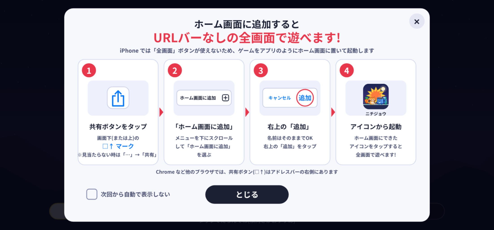
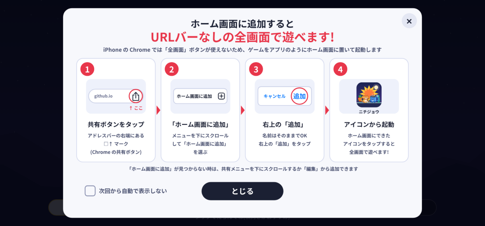
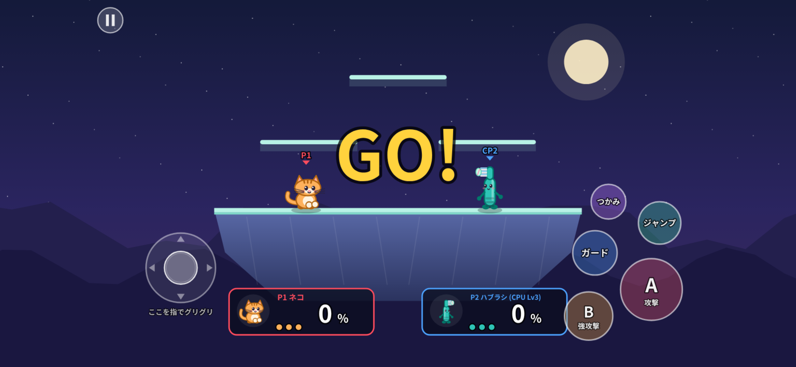

### 画面のボタン（すべて半透明）
| 場所 | 操作 | できること |
|---|---|---|
| 画面の左半分 | バーチャルスティック（指を置いた場所に出ます） | ←→ 移動 / **大きく↑にはじく＝ジャンプ**（戻してもう一度はじくと2段ジャンプ） / ↓ すり抜け・急降下 |
| 右下（大） | **A（攻撃）** | スティックを軽く↑＋A で上攻撃 |
| 右下 | **B（強攻撃）** | スティックを軽く↑＋B で上強攻撃、空中で↑＋B で復帰技 |
| 右中央 | **ガード** | ガード＋スティック←→ で回避、↓ でその場回避、空中で空中回避 |
| 右上 | **ジャンプ** | ジャンプ専用ボタン（スティック↑でもジャンプできます） |
| 右上（小） | **つかみ** | ガードに勝つ「つかみ」（ガード＋A を同時に押してもつかめます） |
| 右上（いちばん上） | **必殺** | 必殺技。ゲージが満タンの時だけ金色に光ってドクドクします（たまっていない時は暗く、ゲージの円が表示されます） |
| 左上 | **Ⅱ** | ポーズ（再開 / キャラ選択へ / タイトルへ） |

スティックとボタンは同時に押せます（マルチタッチ）。指をボタンからボタンへすべらせても反応します。

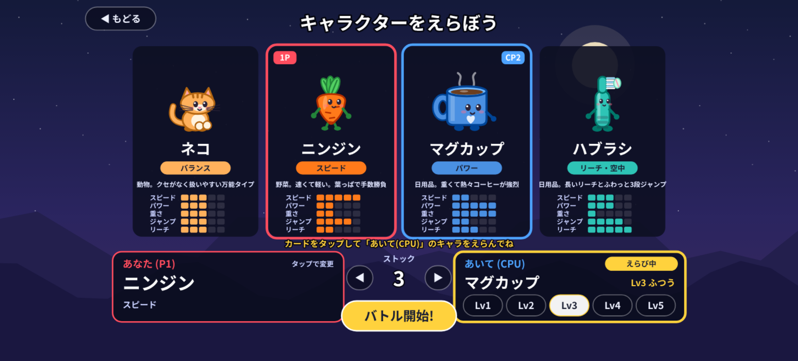
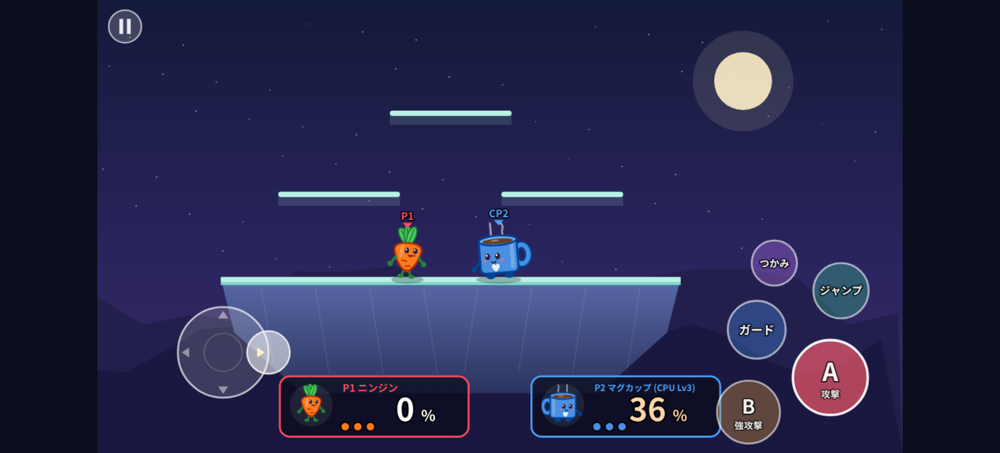
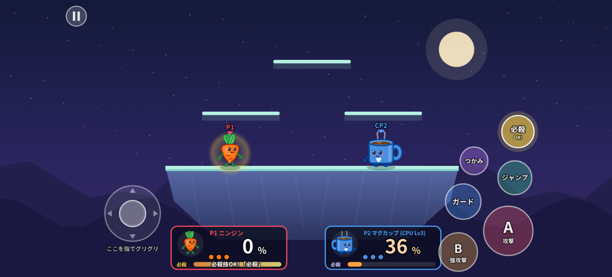
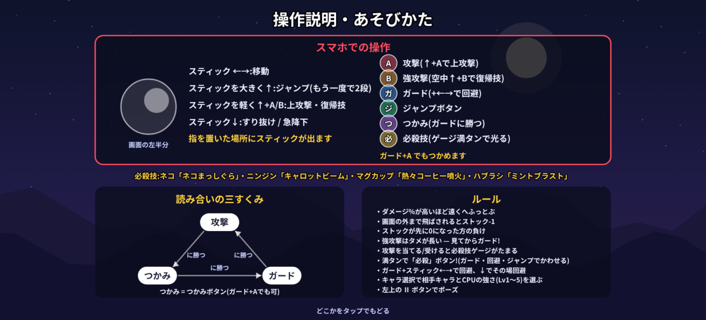

## 開発メモ（PWA）
- `manifest.webmanifest` / `sw.js`（オフライン用キャッシュ）/ `icons/` を同じフォルダに置いて配信します。`index.html` 単体をファイルとして開いても今まで通り遊べます
- 公開ファイルを変更したら `node tools/bump-sw.js` で `sw.js` のキャッシュ版を更新してください（新しい版は次回起動時に切り替わります）
- アイコンは `node tools/make-icons.js` でゲームのキャラ描画から生成しています

## スクリーンショット
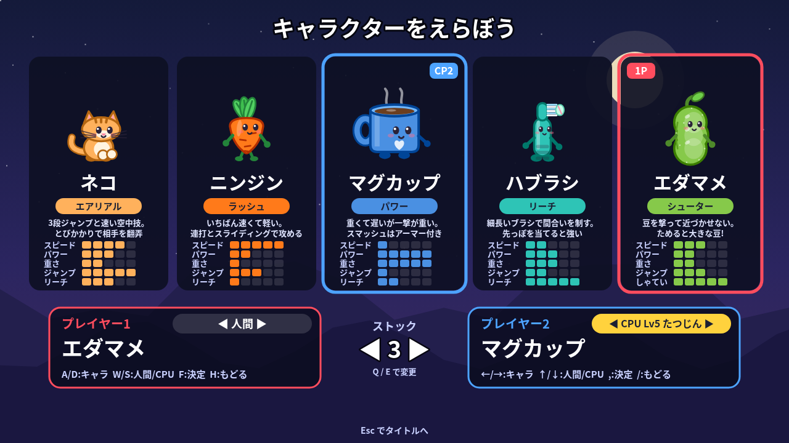
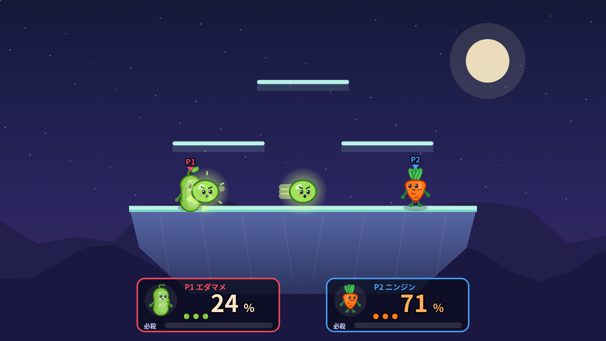
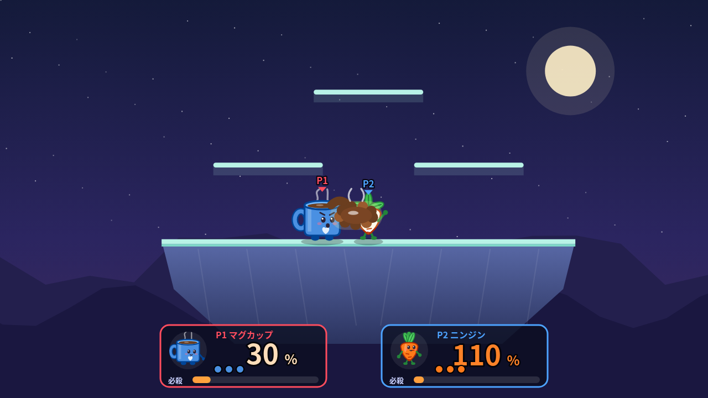
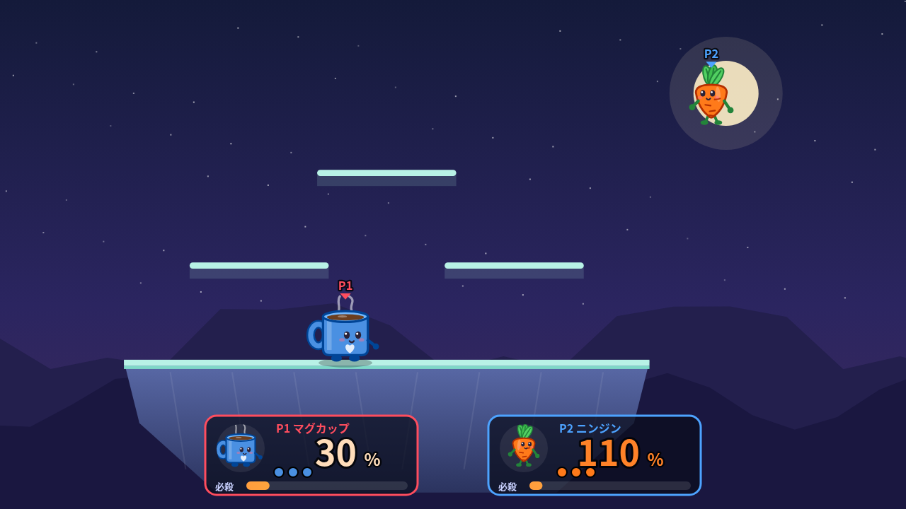
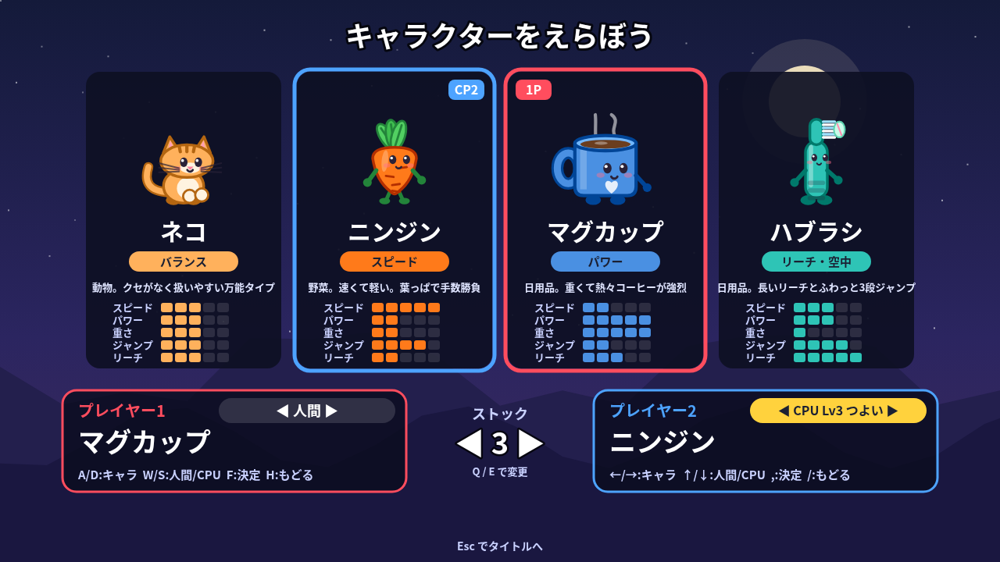
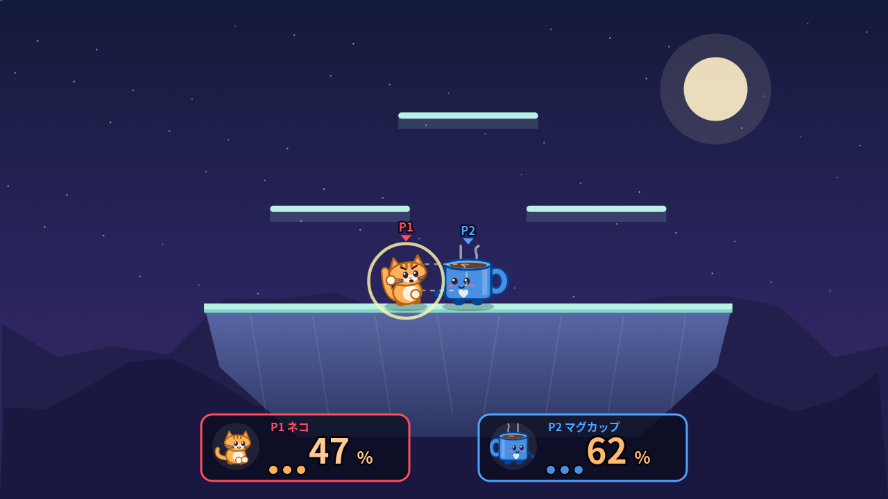
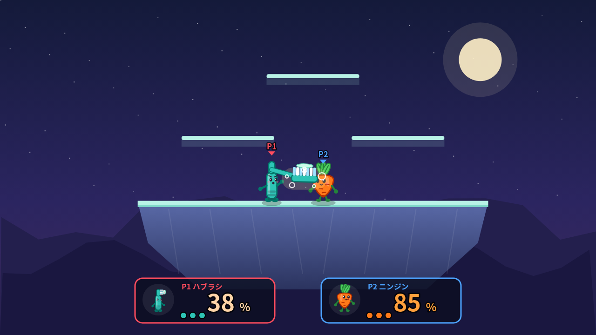
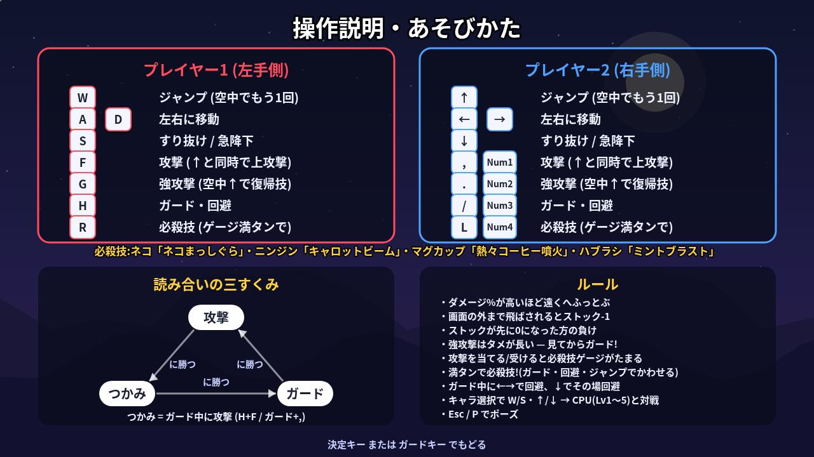
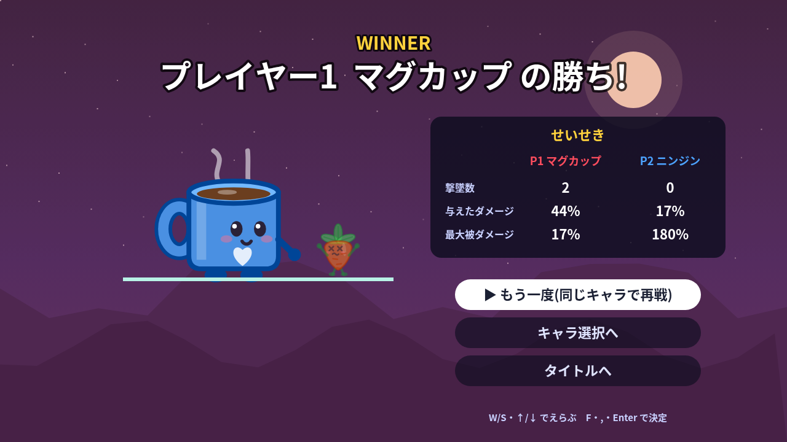
